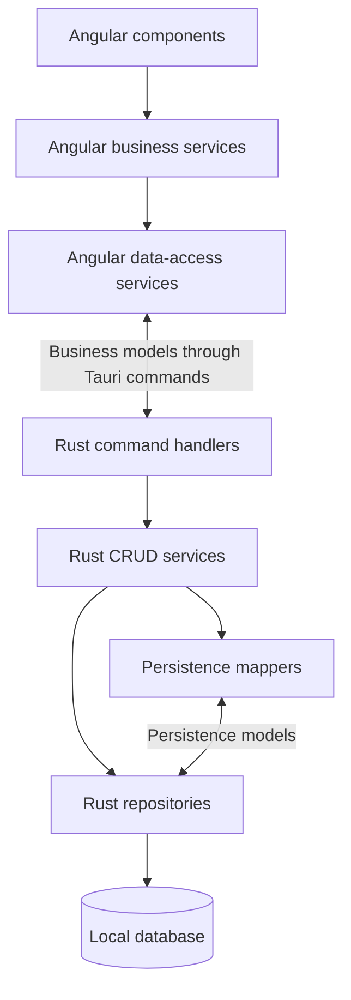

# Application Architecture

## Scope and governing decisions

Ankerzug is a local desktop application built with Angular, Rust, and Tauri for Windows, macOS, and Linux. The approved technologies are defined in TECHSTACK.md; product scope and compatibility contracts are documented below, with acceptance workflows in EXPLORATORY_TESTING.md. The former standalone requirements documents remain available in Git history.

- Angular conducts business operations and owns domain rules.
- Rust owns the local database and all create, read, update, and delete (CRUD) operations.
- Angular and Rust communicate using business models.
- Rust mappers translate between persistence models and business models.
- SQLite with bundled rusqlite stores versioned workspace aggregates; see the implementation contract below.

## Shared group-planning scope — 2026-10-07

The target business model describes a shared group plan. Load profiles, arrow
quantities, durations and free-text descriptions are planned instructions.
Individual measurements,
performance/results evaluation, goal-achievement tracking and measured-load
recommendations are outside scope. Session status describes the group appointment,
not individual participation. Material scope is planned topics/shared equipment.

The weekly comparison and structured-goal UI has been removed. The strict v2
serialization contract remains unchanged. Superseded fields and protection
behavior are retained
as compatibility details until a safe code adaptation. Preserve existing stored
values, backups and recovery; do not remove fields from payloads merely because
they are no longer product requirements. Future views and summaries use only the
shared plan. Historic implementation records do not define the corrected target.

## Retired weekly comparison and structured-goal features — 2026-10-07

Navigation and templates no longer expose `weeks` or `goals` screens. Their
component helpers and service CRUD methods are removed, as are structured goal
lists in mesocycle details and timeline previews. Calendar weeks, planned phase
summaries, quantities, phase load dimensions and free-text descriptions remain.
`WeeklyRecord`, `TrainingGoal` and their macrocycle arrays retain the existing
TypeScript/Rust contract and validation. No schema or backup version changes.
Existing profile-dependent suggestions/warnings and goal-reference handling
remain for compatibility; removing their influence would require a separate
planning-behavior change. Retained records continue through autosave, recovery
and both backup readers.

## Responsibility split

| Layer | Responsibilities |
| --- | --- |
| Angular components | User interaction, form binding, and rendering |
| Angular business services | Use cases, domain validation, calculations, planning rules, and orchestration of CRUD calls |
| Business models | Domain vocabulary and data exchanged between Angular and Rust |
| Angular data-access services | Typed Tauri calls, response handling, and translating transport failures into application errors |
| Rust command handlers | Deserialize inputs, validate boundary data, delegate CRUD requests, and serialize results |
| Rust CRUD services and repositories | Database queries, writes, transactions, and persistence integrity |
| Rust persistence mappers | Convert persistence models to business models and business models to persistence data |
| Local database | Durable storage and database constraints |

Business rules belong in Angular services rather than components or Rust repositories. Rust performs structural validation and enforces storage integrity, including valid references, uniqueness, and transaction consistency. Rust does not calculate training plans or duplicate Angular domain rules.

## Layer flow

Components call business services. Business services operate on business models and use data-access services to load or save data. Angular has no direct database access and does not receive database rows, SQL, or ORM entities.

## Business operations in Angular

Angular business services implement operations such as:

- Creating and editing a macrocycle, including validation of its planning dates.
- Suggesting mesocycles and applying training-load rules.
- Expanding recurring training slots into dated training sessions.
- Assigning sessions to mesocycles and considering holidays and special periods.
- Copying training content and applying templates.

Keep calculations and transformations in testable TypeScript functions where practical. Services orchestrate these functions, persistence calls, and application state.

A business operation reads the required business models, validates the intended change, computes the result, and submits the changes to Rust. Rust stores those results and returns the persisted business models, including generated identifiers where applicable. Angular updates the visible state after successful persistence or explicitly rolls back an optimistic update on failure.

## Business model contract

The business model is the shared conceptual contract between Angular and Rust, represented by matching TypeScript types and serializable Rust structs. It is not a shared in-memory object or a database entity.

- Use domain concepts such as macrocycle, mesocycle, training slot, training session, and training content.
- Exchange plain serializable data through Tauri commands. Keep Angular framework objects and Rust/database implementation types out of the contract.
- Define consistent field names, identifiers, enum values, optional fields, and collection shapes on both sides.
- Represent identifiers as strings at the boundary. Define date-only values as YYYY-MM-DD strings; distinguish these from local times and timestamp values explicitly.
- Use explicit create/update input types where persisted identifiers or backend-managed fields must not be supplied by the caller.
- Reads, creates, and updates return business models; deletes return a documented acknowledgement. Define typed error responses for invalid input, missing records, conflicts, and storage failures.
- Update both language representations together when the contract changes. Automated type generation may be considered later, within the dependency policy in TECHSTACK.md.

Business models may contain domain-oriented relationships and calculated values that do not map directly to columns. Document which values are persisted and which Angular derives. UI-only state, such as selection or expanded panels, stays in Angular.

## Persistence models and mappers

Persistence models exist only in Rust and describe storage details such as table fields, foreign keys, and database-specific representations.

Mappers provide explicit conversions:

- Persistence model to business model when loading records.
- Business create/update input to persistence data when writing records.

Mapping handles naming differences, date/enum conversion, nullability, and storage representation. It must not generate training plans, choose mesocycle assignments, or apply other business policies. Invalid stored values produce explicit mapping errors rather than silent defaults.

Repositories query and write persistence models. CRUD services coordinate repositories and mappers and return business models to command handlers. Schema changes and migrations stay in Rust. A storage-schema change must not leak into Angular unless the business contract itself changes.

## CRUD and transaction boundary

Rust exposes explicit, typed CRUD commands for the required domain resources. Read commands may support documented filters and pagination. Do not expose arbitrary SQL or unrestricted database access to Angular.

A single database transaction cannot span multiple independent frontend command calls. When a business operation must save several related changes atomically, provide a typed batch CRUD command or aggregate-save command in Rust.

Angular determines the intended changes; Rust applies the supplied changes in one transaction and rolls back the entire write on failure. The batch command provides persistence coordination and does not perform business planning. Define conflict handling for writes that could overwrite newer data before introducing concurrent editing.

## Example: generating training sessions

1. Angular loads the macrocycle, mesocycles, recurring slots, and relevant special periods as business models.
2. An Angular business service validates the inputs, generates dated sessions, and assigns their mesocycles.
   Preview session types default to ET for VP1, KNT (Spezifische Kondition) for VP2,
   BAT for WP and ZPT for UWV; UEP and ambiguous/missing assignments retain the
   legacy slot default. Preview edits and protected trainer decisions remain intact.
   Slot type and camp-only fields are hidden in the UI but preserved in storage/backups.
3. Angular submits the resulting session-create inputs through its data-access service.
4. Rust validates the request structure and references, maps the inputs to persistence models, and inserts the batch in one transaction.
5. Rust maps the saved records back to business models and returns them.
6. Angular displays the saved sessions. If persistence fails, it reports the error without presenting the batch as successfully saved.

## Validation strategy

When implementation begins:

- Test Angular domain rules and business operations independently of Tauri and the database.
- Test Angular data-access services against the agreed command and error contracts.
- Test Rust mappers, CRUD behavior, database constraints, migrations, and transaction rollback with the selected database.
- Verify contract serialization across the TypeScript/Rust boundary, including optional values, enums, identifiers, and dates.
- Validate complete workflows and local persistence on Windows, macOS, and Linux.

Dependency decisions and versions are recorded in TECHSTACK.md.

## Revised training-planning implementation

The application implements the version-2 aggregate and planning policies described
below. Repeatable acceptance and outstanding native release gates are maintained
in [EXPLORATORY_TESTING.md](EXPLORATORY_TESTING.md). Product release labels are
independent of database schema, backup and exchange-format versions.
Native installed/offline/restart acceptance on all three platforms remains open.
Angular owns configurable planning, summaries and warnings; Rust owns strict
version readers, conversion, reference validation and transactional storage.
The pre-release simplification below is historical and superseded by this contract.

## MVP implementation contract

`src/app/models.ts` and `src-tauri/src/models.rs` define the matching serializable
version-2 contract. `fixtures/workspace-v2.json` is shared by TypeScript and Rust tests;
`fixtures/workspace-v1.json` remains immutable migration/backup input.
The workspace boundary exposes typed operations:

- `load_workspace() -> Snapshot { revision, workspace }`.
- `save_workspace({ input: { expectedRevision, workspace } }) -> Snapshot`.
- `create_backup() -> string | null` (the trainer-selected backup file location, or cancellation).
- `restore_backup({ contents, expectedRevision }) -> Snapshot`.
- `recover_previous({ expectedRevision }) -> Snapshot`.
- `read_game_attachments({ ids }) -> AttachmentBytes[]` for an explicit viewer or package export.

`Workspace` owns macrocycles and global templates. Template navigation and editing
are available without a selected or existing macrocycle. New workspaces start
with an empty template collection; loading does not seed templates or alter
existing templates. A macrocycle owns competitions with A/B/C priorities, its main A competition
reference, independent end date, periods, phases, slots, sessions, compatibility
weekly profiles/scoped goals, proposal/warning decisions and
generation exclusions.
Contents are ordered arrays owned by sessions/templates. This implements ownership
without leaking persistence entities. IDs are UUID strings assigned by Angular
when preparing a new aggregate; input revision is never trusted as the stored
revision. Empty optional text is `""`; optional numeric values and absent phase/slot
references are `null`. Arrays are always present. All dates are ISO date-only
strings and local times are `HH:mm`. Derived counts, warnings, selection and previews
are never stored. Migrated mesocycle `legacyArrowCount` retains its original 0-100 meaning as
internal compatibility metadata; it has no editor field. Nullable
Mesozycles store independent volume and specificity 1-5 scales. Intensity is not an
editable mesocycle value; historical values remain compatibility data and do not affect
new session suggestions. Session and template profiles retain independent volume,
intensity and specificity scales. Absolute session/block
planned arrow counts are nullable u32 integers (0-4294967295), matching
TypeScript bounds. The unchanged v2 DTO also contains superseded measurement
fields and goal statuses; these are compatibility data, not the target model.
Mesocycles store a `color` enum (`grey`, `lightGreen`, `darkGreen`, `blue`,
`orange`, `red`), independent of phase type. New manual/proposed phases default to
`grey`; Rust defaults missing colors in existing v2 documents/backups and v1
conversion to `grey`, while rejecting unknown or null colors. No schema or backup
version change is needed for this additive field. The editor displays German
labels and uses the selected color for the card marker.
The workspace also stores one complete hexadecimal `sessionTypeColors` map for all
canonical session types. It is independent of mesocycle card/calendar colors;
missing maps from older documents receive the default palette, while present
incomplete, unknown, or malformed maps are rejected atomically.
Completion is the `completed` status; no separate completion boolean exists.

`PlannerService` owns business operations and serialized autosave; `planning.ts`
contains deterministic functions. Components bind forms, navigation, confirmation
and preview state. DataAccessService wraps only explicit typed IPC operations.
Errors have `code` (`invalidInput`, `conflict`, `storage`, `invalidStoredValue`) and
`message`. Deserialization errors from Tauri are normalized as transport failures.

The current SQLite schema is `user_version=6`; business documents and backups remain
version 2. In the original SQLite `user_version=2` layout, the private
`StoredDocument` validates schema, safe integer revision and business payload.
A version-1 upgrade validates and converts every live and recovery document before
rebuilding both tables in the same immediate transaction. IDs, revisions, names,
manual flags, contents and origin exclusions survive. Old realization/taper
instances remain separate UWVs targeted at the migrated main competition;
foundation maps to VP1, build to VP2, specific to WP, realization/taper to UWV,
and recovery to UEP, preserving their IDs, dates and names;
repeated WP/UWV instances are numbered chronologically. Unknown historic load
values remain null, old arrow values become legacy metadata and endDate includes
retained record endpoints. Migration notes explain the compatibility mapping and
profiles requiring trainer review; the mapping does not assert equivalent loads.
Old category text is retained where area mappings are ambiguous. New cycles default
their end date to the main competition date; a migrated end date must not truncate
retained phases, sessions or special periods. Failed conversion leaves original
live and recovery documents, revisions and schema versions unchanged.
`legacy.rs` contains the strict v1 DTO reader, original structural validator and
explicit conversion boundary; Angular never converts persistence payloads.
Corrupt/future data fails without replacement. The aggregate and backup size limit is 200 MiB.

SQLite `user_version=3` keeps game-PDF bytes in a private `game_attachments` BLOB table.
The workspace document and ordinary autosave contain attachment metadata only; newly selected
or imported bytes are submitted once with the matching aggregate save. Reads for viewing and
game-package export fetch only the requested attachment IDs. Backups and recovery snapshots
still include complete attachment bytes, while the v2-to-v3 migration atomically extracts
existing document bytes into the BLOB table before replacing the document payload.

SQLite `user_version=4` retires planned shared-equipment changes and material warnings.
The v3-to-v4 upgrade normalizes live and recovery payloads in one immediate transaction,
discarding only those retired fields. Training-content material remains free text.

Every workspace write uses `BEGIN IMMEDIATE`, compares the expected revision, and replaces
the entire aggregate atomically. An older window's write is rejected. Autosave
captures a deep copy, serializes requests, tracks edits during an in-flight write,
and never replaces newer form values with an old response. Invalid and failed
edits remain in the UI. Closing the native window flushes pending changes; the
user must confirm discarding a failed write.

Version-2 backups serialize all business data; restore accepts v1 through explicit
conversion and v2 directly. Future versions and unknown fields/enums are rejected. Restore validates before writing,
checks the current revision, and inserts the previous payload into `recovery` in
the same transaction as replacement. `recover_previous` restores the latest such
copy, saving the current state for recovery in turn. Invalid or failed restores
roll back both writes. Rust opens the backup Save As dialog, validates a `.json`
destination and writes through a synced temporary sibling before replacement.
Cancellation returns null without changing workspace data or creating a file;
Angular neither supplies paths nor receives backup bytes. No frontend filesystem
permission is available.

## MVP planning policy

- Date intervals include both endpoints. Date iteration uses UTC day arithmetic,
  while slot start times remain local wall-clock strings (including DST weeks).
- Phase proposals use an ordered catalog of editable phase definitions. Each entry
  owns its stable code, label, role, proposal order/weight, default profile and
  applicable phase warning/template parameters; shared warning thresholds remain
  explicitly cross-phase. The shipped catalog preserves VP1, VP2, WP, UWV and UEP
  semantics, while entries such as VP3 or WP2 require no UI or Rust shape change.
  Legacy fixed records are normalized before strict validation and saved in catalog
  form after the next successful write. Phase proposals use editable weights, UWV maximum duration, short-cycle and
  close-peak thresholds. Whole days are allocated by largest fractional remainder
  with chronological tie order. Zero-length phases are omitted and explained.
  Close A peaks continue WP/UWV; same-day A events share one UWV targeted at the
  first event in deterministic date/ID order. B/C events do not restart preparation.
  End dates after the last A peak receive UEP. All starter values are editable
  recommendations, not DSB rules; the technical horizon remains 3660 days.
- VP1/VP2/WP/UWV/UEP are manually available with target editing.
  Repeated phases retain internal sequence metadata; the editor exposes no instance-number field. A null
  UWV target warns; dangling competition, goal, phase and slot references fail.
  Replacing phases requires deliberate confirmation and previews every assignment.
  Phases referenced by manual sessions or phase goals are retained; overlaps warn.
- Holiday modes use normal/reduced/suspended/camp and retain unchanged as a manual
  no-change policy. School holidays initially use normal with visible mode guidance;
  no youth profile is inferred from free text. Reduced periods may explicitly retain
  slots and/or set remaining duration percent. No configuration means a visible
  reduced marker. Suspended periods initially deselect rows; trainer overrides
  remain possible. Camp-only slots run in explicitly configured camp periods.
- Session type determines the removable 30-minute archery warm-up. Pure `AT`, `MT`
  and `M-T` sessions omit it. All other canonical session types use the regular
  archery warm-up. Phase/week content
  and load suggestions require apply/dismiss decisions keyed by their context.
  Opening a session does not change it. Blocks support multiple stable domain
  areas and preserve ambiguous legacy categories as text for trainer review.
- Historical mesocycle `defaultTemplateId` values remain compatibility data in
  older v2 documents and both backup readers without a schema-version change.
  They are neither edited nor applied to sessions. Previous-session reuse copies
  planned contents only; it keeps target date, duration, type, profile and status
  and clears copied compatibility observations.
  Content suggestions append a chosen phase/week alternative; optional profile
  application fills only unknown dimensions, preserving trainer values.
- Monday weeks aggregate each session once. Explicit session arrow counts take
  precedence; otherwise only complete block sums are totals. Incomplete block
  values contribute visible partial sums with session coverage. Moved origins
  are omitted; cancelled plans remain visible. Session areas are non-additive
  counts. Target summaries use current planned values and never multiply them by
  group membership. Legacy measurement/snapshot handling remains compatibility
  behavior in unchanged code, not an obligation for new planning views.
- Templates copy type, areas, planned load and block planning values with new
  IDs and independent arrays. Organizational appointment status survives template
  application; superseded stored fields follow the existing compatibility rules.
- Structured goals are retained only for compatibility; no goal CRUD or display
  workflow remains. Existing reference transformations continue to maintain storage
  integrity during phase/session operations. Planned load/content/phase gaps warn
  using visible configured thresholds. Shared-equipment change records and their
  warnings are retired by the v3-to-v4 migration described above.
  Acknowledgements store context keys, not calculated messages; unchanged context
  stays suppressed, changed context is evaluated again. Warnings never block saves.
- Occurrence identity is the original slot ID plus date, independent of edits to
  the generated session. Persisted exclusions prevent deleted or unchecked dates
  being resurrected. Initial generation and unchanged regeneration are idempotent.
  `regeneration.ts` recomputes all source occurrences, compares existing origins,
  and previews additions, updates, removals, exclusions, assignments and conflicts.
  A stale preview is rejected by comparing its source snapshot to the current cycle.
  Accepted changes use the same validated, revision-checked aggregate save.
  Source-disabled/obsolete dates do not create permanent deletion exclusions;
  deliberately declined new dates do. Detached sessions survive regeneration.
- Optional `generationBaseline` records an independent copy of generated planning
  fields and contents, distinct from legacy snapshot metadata. This additive
  field stays within the unreleased v2 contract: missing/null baselines are accepted,
  absent values are omitted on Rust serialization, and v1/v2 readers remain supported.
  Historical snapshot content IDs and phase references are metadata, not live entities.
  No baseline is fabricated for migrated or older v2 sessions; they are protected.
  Manual flags, deviations from baseline, goals, suggestions and organizational
  status protect sessions. Existing compatibility safeguards also protect legacy
  data. Conflicts require explicit keep/apply choices; eligible planned sessions
  can accept scheduling/assignment changes, preserving
  their contents, type and load decisions. Protected sessions cannot be removed by
  regeneration. Keeping an automatic change or overriding an assignment records a
  trainer decision. Untouched updates preserve session and surviving default-content
  IDs; type changes may replace untouched warm-up defaults. Destructive removals
  require confirmation; broader undo remains deferred product scope.
- Bulk session deletion confirms the selected count once and applies the existing
  single-session deletion semantics, including compatibility goal cleanup and
  occurrence exclusions, through the revision-checked aggregate save.
- Deleting a phase clears references and retains sessions. Slot deletion either
  retains all sessions or deletes only untouched generated sessions, as explicitly
  selected; retained sessions lose their slot reference but keep origin identity.
  Deleting a macrocycle removes its owned aggregate, preserving global templates.
- `manuallyModified` tracks trainer edits; `individuallyPlanned` tracks edited
  contents or template application. An untouched warm-up alone is still unplanned.
  Template copies have independent content IDs. Empty-only mode fills zero-block
  sessions; append shifts offsets by the last block's end and extends duration to
  cover the appended template. Replace/append/empty targets are previewed as a
  table showing targets, block counts and duration changes; replacements require confirmation.

## Date-field presentation

All nine planning date fields use the shared standalone `DateFieldComponent`,
implemented with Angular, HTML and CSS. Its ControlValueAccessor displays German
`DD.MM.YYYY` text and accepts both that format and pasted ISO dates. Valid edits
emit the existing ISO date-only contract; calendar selection does not introduce
local timestamps or timezone conversions. The component reuses the pure domain
calendar-date validator. Unfinished or impossible typed values stay invalid in the
form and are rejected by workspace validation before autosave, including optional
slot dates, rather than silently clearing a previously entered date.

The month popup provides Monday-first weeks, selected/today indicators, month
navigation, clear/today controls, arrow/Home/End/PageUp/PageDown navigation, and
Escape dismissal with focus restoration. Popup navigation alone does not change
the model. The control handles disabled Angular forms and labels/errors for
assistive technology. No UI library or additional dependency was introduced.

## Historical version-1 pre-release data contract

Macrocycles omit description, bow class and performance level; the main competition
omits type, distance and target/format. Mesocycles omit intensity 1-5 and target
volume. `intensityPercent` becomes `arrowCount` with unchanged optional integer
0-100 validation. Sessions omit location, intensity, specificity and expected
volume and add an editable `name` string, initially copied from the training slot.
Slot and competition locations, mesocycle specificity and session notes,
and descriptions on mesocycles/templates retain their existing responsibilities.

TypeScript, Rust and the shared version-1 backup fixture change together. At that earlier stage there
was no deployed schema to support. The version-2 implementation above now converts
this strict version-1 format explicitly; no silent aliases are used.
Existing development payloads with removed fields fail explicit validation.

## Simplified session and content editors

Session editors omit planned arrows and volume/intensity/specificity controls.
Session and template content editors omit subcategory, exercise reference and planned
arrow counts/load. Session content exposes `notes` as a multiline “Anmerkungen”
editor with a maximum of 400 characters; template-only compatibility controls remain
hidden. Hidden planning fields remain stored. Superseded measurement fields remain
solely for storage and backup compatibility; the target does not expose or evaluate
them. Blocks expose `material` as a free-text string and the existing `content` as a
large multiline “Inhalte” editor. Copies, templates and generation baselines retain
all three strings. Rust defaults missing
`material` to an empty string when reading existing v2 documents and backups or
converted v1 data; new payloads serialize it explicitly. Schema/backup version 2
and both backup readers remain unchanged.

## Consecutive content timing and pauses

Angular derives `startOffsetMinutes` from ordered block durations: the first starts
at zero and each subsequent block starts at the previous end. Session and template
editors omit start inputs. Loading/restoring/recovering a workspace and editing it
normalizes block offsets, including generation baselines, while retaining IDs,
order, durations and compatibility data. Template application also derives consecutive
offsets. Historical snapshot offsets are derived metadata under this rule.
The existing category contract adds `Pause`, displayed in the block type selector.
Pauses have a positive planned duration and participate in timing like other
blocks; they need no training area. Rust accepts the new category and keeps
structural validation; timing calculations remain in Angular.

## Session PDF export boundary

The early requirement-30.2 slice exports one selected training session.
`PlannerService` waits for successful autosave, captures a detached business-model
snapshot and loads the A4 renderer on demand. The renderer owns text wrapping,
ordered block timings and pagination; it never changes stored offsets or planning
values. PDF text uses the bundled Noto Sans font. The presentation omits session type,
status and areas; time panels and continued-block labels structure the plan.
Unsupported glyphs fail explicitly.

`DataAccessService.exportSessionPdf(filename, bytes)` wraps
`export_session_pdf({ filename, bytes }) -> void`. Rust validates a safe suggested
PDF filename and a PDF payload capped at 20 MB, then opens the viewer directly.
Both `export_session_pdf` and the PDF branch of `export_plan_file` delegate to
`pdf_export::export_pdf`. PDF plan export returns null after opening; its frontend
reports viewer success rather than interpreting this as file-dialog cancellation.
No Save As dialog or filesystem write is part of opening a PDF.

The shared operation opens a uniquely labelled Tauri window at the embedded
`index.html?pdfViewer` entry. Each export creates its own window. The backend holds
the generated bytes and filename in a window-scoped in-memory map;
`read_pdf_viewer()` derives the key from the calling window, never a supplied path
or identifier. Closing the window removes its entry; failed window creation also
removes it and reports an error.

**Speichern unter …** in the viewer calls `save_pdf_viewer() -> string | null`.
Rust derives the document from the calling window, opens the native Save As dialog
on a blocking worker, and writes only the user-selected PDF path. Cancellation
returns null; storage failures use the existing `AppError` contract. A temporary
sibling file is synced before replacement so failed writes preserve an existing
destination. Saving does not reopen or replace the viewer; cancellation or failure
leaves it printable. No frontend filesystem paths or general filesystem permissions
are accepted. Exports are presentation documents, not restorable backups; the
workspace schema and backup versions are unchanged.

The viewer bootstraps a separate standalone Angular component and loads the local
PDF.js legacy renderer/worker on demand. It renders the exported bytes as 150-dpi
A4 page canvases and enables **Drucken** only after every page is rendered.
The button and Ctrl/Cmd+P call the window-scoped native Tauri print command;
this uses the WebView print operation and reliably opens the dialog on macOS.
Print CSS hides controls and places each page on a separate A4 sheet without
additional margins. Loading or rendering failures disable printing and ask the trainer to restart the PDF export. The viewer does not load or modify the workspace. Worker assets and
the Apache-2.0 license are embedded; CSP permits same-origin workers and asset
requests. No additional native plugin permissions are required.

## Mesocycle timeline operations

`timeline.ts` computes detached, validated previews for date boundaries, split,
merge, insertion and deletion. A source fingerprint rejects previews after any
cycle edit. The component renders previews and assignment choices; PlannerService
applies phases, goals and assignments together through the existing revision-checked
workspace autosave. No IPC, schema or backup version changes are required.

Dates are inclusive. Splitting keeps the original ID and goals on the first part,
creates a new ID for the second, and copies all profile/description/compatibility
metadata without interpreting legacy load values. Merging requires chronological
neighbors with exactly adjacent dates, keeps all first-phase settings and ID, and
transfers the second phase's goals and assigned sessions to the first. Insertion
requires a gap before the next phase, leaves neighbors intact, and creates a grey
VP1 phase with unknown load values. Deletion promotes scoped goals to macrocycle
scope and initially leaves affected sessions unassigned.

Other automatic assignments follow unique date matches; existing manual assignments
remain selected when their phase survives. Every assignment is editable before
application. Changed assignments become manual decisions for regeneration; baseline
references remain historical metadata. Contents, compatibility data, session/slot identities,
exclusions and templates remain intact. Spatial planning warnings, including retained
assignments outside phase dates, remain ignorable. Invalid ranges and missing live
references block application. Persistence failures retain the intended transformation
for retry and expose the existing failed autosave state. Historical per-phase
template defaults follow the compatibility policy above and are not applied to sessions.

## Derived planning views

`planning-views.ts` provides persistence-independent session filtering, calendar
ranges/navigation and mesocycle planning summaries.
`PlanningViewsComponent` renders the month/week calendar and
mesocycle detail; AppComponent renders the filtered table and owns navigation to
its existing session editor. All views use the same live business aggregate and
emit business objects, never storage rows. Calendar mode/anchor and table filters
are transient UI state; returning from the editor preserves them.

Filters combine phase, source slot, inclusive start/end dates, organizational
status and individually planned content. Built-in warm-up content does not change
`individuallyPlanned`; the views retain the existing trainer/template distinction.
Sorting uses ISO dates followed by local HH:mm and stable identifiers. Calendar
weeks begin on Monday, include neighboring month days and mark dates outside the
macrocycle. Mesocycle ribbons span their inclusive dates in each visible week;
continuations have square ends and overlapping phases use separate grid rows.
`calendarWeeks` derives these spans without changing phase or session data.
Date-only calculations/formatting use UTC to avoid timezone drift;
local appointment times are displayed as stored, without timestamp conversion.

New phase summaries describe the current shared plan: moved origins are omitted
from totals and cancelled plans remain included. Planned duration comes from the
current session; an explicit planned arrow count takes precedence over content
counts. Complete content counts are summed once; incomplete content counts retain
partial totals and coverage, and no entries are distinct from a known zero.
The overview additionally renders a static two-row summary for every mesocycle:
metadata with inclusive duration and a weighted session-type composition bar.
It has no date-positioned elements and therefore does not restore the removed
macrocycle timeline.
Compatibility observations, original-plan snapshots, legacy 0-100 phase values
and goal-achievement fields do not participate in these summaries. Periods overlap
phase intervals inclusively; competitions use their dates. Structured goals are
not included in detail summaries. Derived views require no storage migration.

## Version 1 macrocycle exchange and readable exports

A macrocycle package is `{ kind: "ankerzug-macrocycle", formatVersion: 1,
dataVersion: 2, cycle: MacroCycle, templates: Template[] }`. Package versions are
independent of product releases and backup versions. Include the complete cycle,
compatibility records, generation baselines/exclusions and templates referenced
by mesocycle defaults. Copies already embedded in sessions remain independent.
Rust deserializes strictly and validates this closed business-model aggregate;
unknown versions/fields, malformed values and dangling references fail explicitly.
Both existing backup readers and schema version 2 remain unchanged.

Angular constructs an import preview, assigns fresh IDs to all imported entities
and remaps main/target competitions, default templates, session phase/slot links,
retained slots, scoped compatibility goals and generation snapshots. Generated
slot@date origins and exclusions follow the remapped slot IDs; historical values
without a live reference remain historical. The preview lists collisions and ID
mappings. Imported cycles/templates are appended, never replace existing records.
A stale preview fails. The existing revision-checked aggregate save commits the
import atomically; failed writes retain the intended import for explicit retry.

Native commands `read_macrocycle_package`, `validate_macrocycle_package` and
`export_plan_file` exchange typed business packages or bytes, never paths supplied
by Angular. Rust opens scoped dialogs, limits reads/writes to 20 MB and writes via
synced temporary sibling files. Cancellation returns null; errors use AppError.
Export waits for successful autosave and renders a detached plan snapshot.

Markdown, CSV, plan PDF and the print view show shared planned data, competitions,
phases, special periods, session/block instructions, material and trainer notes.
They omit retired goals, individual measurements and results. CSV uses UTF-8 BOM,
quoted semicolon fields and protection against spreadsheet formula interpretation.
Readable exports are not backups or lossless import formats.

ICS uses CRLF, UTF-8 octet-aware folding, escaped TEXT, stable cycle/entity UIDs
and a UTC export DTSTAMP. Sessions use floating local DTSTART and planned-duration
DURATION; competitions use DATE DTSTART (one day). Cancelled and moved origins
use STATUS:CANCELLED; completed describes the appointment and exports CONFIRMED.
There is no timezone conversion or UTC guess, including at DST boundaries. Importing
an ICS file is calendar-client behavior, not synchronization; deleted records are
absent rather than exported as cancellation tombstones.

## Standalone training-session template exchange

A template package is `{ kind: "ankerzug-templates", formatVersion: 1,
dataVersion: 2, templates: Template[] }`, with at least one complete template.
Users export one template or all current templates independently of a macrocycle.
Rust strictly validates package versions, template/block IDs, values and enums.
`read_template_package` opens a native file picker; `export_plan_file` accepts
format `templates` and validates the same package before saving. Both reuse the
existing 20 MB limit, scoped dialogs, UTF-8 handling and safe file replacement.

Angular previews template names/counts and identifier collisions, remaps every
imported template/block ID, and appends independent copies with the existing
revision-checked aggregate save. Existing template defaults and session copies
remain untouched. Stale previews fail; cancelled imports do not write; failed
saves retain intended copies for retry. Package contents preserve all planning,
material/free-text and compatibility fields. Storage/schema and backup readers
remain unchanged. Training-game storage, attachment lifecycle and exchange
contracts are documented in the following section.

## Version 1.1 game contracts (2026-10-07)

Workspace adds an optional `games` collection, defaulting to empty in existing
v2 documents. Content adds optional `gameId`; absent/null means no selection.
`Game` exchanges string ID/name/description, boolean `single` and `team` flags (at least one true), four
integer ratings (`effort`, `fun`, `duration`, `competitionProximity`) and an
`attachments` array of `{ id, filename, bytes: number[] }`. Rust stores this entire
aggregate in the existing SQLite transaction; attachments have no external path.
Empty collections and absent references are omitted from Rust serialization to
preserve old fixtures. Schema/backup version 2 and transactional v1 conversion
remain supported. Older strict readers reject new fields rather than discard them.

The exclusive game `kind` is retired. When reading stored workspaces, recovery
records or backups, its presence causes it to be removed and both `single` and
`team` to be set to true, irrespective of its former value. New games default
to both forms; subsequent edits retain the selected flags. This is a hard reset
of the former classification, with no database migration or version increment.
New exchange packages require both boolean flags; old game-kind packages must
be regenerated. The package envelope `kind` remains unchanged.

Game packages use `kind: ankerzug-games`, format/data versions 1/2 and `games`.
Macrocycle/template packages with game closure use format version 2 (data version
2); format version 1 remains accepted only without game data. Closure includes
session contents, generation baselines and exported template contents. Import
remaps all game/attachment IDs and block references, appends independent copies,
and uses the existing revision-checked aggregate write. Angular validates all
PDF pages before showing the preview. Retry after a failed save reuses the intended
aggregate rather than creating a second import. Native attachment selection returns
bytes and basename only; Angular supplies fresh IDs after usability validation.
PDF viewing uses the existing window-scoped byte contract, with per-page print
sizes derived from the PDF dimensions instead of forcing attachment pages to A4.

## Optional native exploration infrastructure

The `exploration` Cargo feature registers an embedded loopback WebDriver server
and frontend diagnostic capture. It requires a dedicated absolute storage path
and explicit port; normal builds contain neither the driver nor the override.
The Node CLI builds into a separate target directory and drives real Angular
forms, Tauri IPC and SQLite. The optional Linux desktop adapter handles app-owned
native dialogs and real window-manager closure. No business rule or persistence
command is replaced for testing. See [EXPLORATORY_TESTING.md](EXPLORATORY_TESTING.md)
for evidence, remaining OS-dialog boundaries and acceptance charters.

## Versioned welcome wizard

The main Angular application opens a six-page German welcome dialog when the
locally acknowledged version is absent or lower than `WELCOME_MODAL_VERSION`.
The constant starts at 1 and changes deliberately for important announcements,
independently of application releases, SQLite schema, business data and exchange
formats. Separate PDF viewer windows never initialize this workflow.

`WelcomeService` owns the version comparison and acknowledgment state; the
standalone dialog owns rendering, navigation and focus. Closing through the close
button, Escape or the final action acknowledges the current version. Displaying
the dialog and navigating pages do not acknowledge it. A failed acknowledgment
allows dismissal but leaves a visible retry action; a failed initial read also
reports an error and supports retry without blocking training planning.

Typed commands `load_welcome_modal_version() -> number | null` and
`acknowledge_welcome_modal({ version }) -> number` use the existing error contract.
Versions are positive unsigned 32-bit integers. SQLite schema v6 adds a private
singleton `app_preferences` table with `welcome_modal_version`; an absent row means
unseen. The v5-to-v6 migration is transactional and does not rewrite workspace or
recovery data. Acknowledgment stores the maximum of the existing and requested
versions atomically, so an older application cannot lower a newer acknowledgment.
Invalid stored values fail explicitly. Preferences do not participate in workspace
revisions, autosave, backup payloads, restore or recovery; both backup readers remain
unchanged.

The dialog uses native HTML dialog semantics, keyboard focus containment and
restoration, a persistent close control, previous/next actions and a page counter.
Backdrop clicks do not dismiss it. Page transitions respect reduced motion. Each
page has one heading and a body of at most 300 characters. Progress describes
organizational session status, and AI import describes external conversion through
the existing import instructions rather than an embedded AI service. No dependency
or additional native permission is required.

## External help

The sidebar's “Hilfe” action above “Info” calls the argument-free `open_help`
command. Rust opens only `https://www.ankerzug.net/help` in the system browser
using the platform handler (`start` on Windows, `open` on macOS, `xdg-open` on
Linux). Failures appear in the existing UI notice. No arbitrary URL or process
arguments cross IPC, and no dependency or plugin permission is added.
